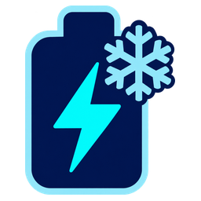

# Netzladen Winter

Home-Assistant-Integration für die Netzladung eines Heimspeichers. Sie berechnet den Ziel-Ladestand aus Verbrauch, PV-Prognose und optionalem Wetter. Alle Einstellungen liegen in der Home-Assistant-Oberfläche.

## Voraussetzungen

- **Home Assistant 2026.11 oder neuer.**
- **Speicher und Wechselrichter:** Home Assistant braucht den aktuellen, minimalen und maximalen Akkuladestand. Speicherkapazität und Backupreserve kannst du auch direkt eingeben. Für die aktive Steuerung braucht es zusätzlich schreibbare Regler und Rückmeldungen. Für Sungrow ist M. Kaisers Modbus-Anbindung ein Beispiel. [Sungrow-Anbindung von M. Kaiser](https://github.com/mkaiser/Sungrow-SHx-Inverter-Modbus-Home-Assistant)
- **Verbrauch:** Ein fortlaufender Hausverbrauchszähler oder die Zähler für PV, Netz und Batterie zur Berechnung des Verbrauchs. Wenn du Wärmepumpe oder Wallbox berücksichtigen willst, wähle die passenden Energiezähler.
- **PV-Prognose:** Ein Sensor mit einer vollständigen Stundenprognose. Solcast liefert das passende Format. Andere Quellen kannst du ebenfalls verwenden, wenn ihr Sensor die Stundenwerte als `detailedHourly` mit `period_start` (Zeitstempel mit Zeitzone) und `pv_estimate` bereitstellt. [Solcast für Home Assistant](https://github.com/BJReplay/ha-solcast-solar)
- **Optional:** Eine Wetterentität mit Stundenprognose und ein Außentemperatursensor. Einen Sensor für den aktuellen Arbeitspreis brauchst du nur beim dynamischen Tarif.

## Installation

Über HACS als benutzerdefinierte Integration installieren, Home Assistant neu starten und **Netzladen Winter** unter **Einstellungen → Geräte & Dienste → Integration hinzufügen** einrichten.

## Einrichtung

| Bereich | Was du einstellst |
| --- | --- |
| **Speicher** | Aktueller, minimaler und maximaler Ladestand, Kapazität und Backupreserve. Die Ladegrenzen für Speicher und Netz sind separat einstellbar. Beim Netzladen gilt der kleinere Wert. |
| **Verbrauch** | Fortlaufender Hauszähler oder Energiebilanz aus PV-, Netz- und Batteriezählern. Bei Bedarf Zähler für Wärmepumpe und Wallbox auswählen. Die Wallbox wird vom gemessenen Hausverbrauch abgezogen. |
| **Prognose** | PV-Stundenprognose für heute, optional auch für morgen. Bis genug Messwerte vorliegen, gilt die eingestellte Ersatzlast. |
| **Tarif** | Festes Fenster ab Mitternacht bis zum einstellbaren Ladeende oder dynamische Freigabe über einen aktuellen Preissensor. Beide Modi gelten in den ausgewählten Monaten. |

Im **dynamischen Modus** liefert der Preissensor den aktuell geltenden Arbeitspreis pro Kilowattstunde, etwa 18 ct/kWh. Die Ladung kann unter deiner Preisgrenze starten. Bei genau der Grenze läuft eine begonnene Ladung weiter. Oberhalb der Grenze oder bei einem ungültigen Preis endet die Freigabe. Unterstützte Einheiten sind ct/kWh, EUR/kWh und EUR/MWh.

Die Einstellung **Maximale Zeit ohne Preismeldung** zählt ab der letzten Meldung des Sensors an Home Assistant. Bleibt eine neue Meldung länger als die eingestellte Zeit aus, endet die Freigabe auch bei einem zuletzt günstigen Preis. Standard sind 90 Minuten. Eine neue Meldung mit demselben Preis setzt die Frist zurück.

## Vorschau und Steuerung

Die **Vorschau** ist voreingestellt. Die Integration zeigt Ziel-Ladestand, konservative PV-Prognose und Betriebsstatus an.

Für die **aktive Steuerung** wählst du drei Regler für Ladegrenze, Zwangsladeleistung und maximalen SoC, zwei Auswahl-Entitäten für EMS-Modus und Ladebefehl sowie deren tatsächliche Rückmeldungen. Die Leistungsregler können W oder kW verwenden. Ohne gültige Speicherdaten und stündliche PV-Prognose startet keine Netzladung.

Die Integration wartet vor dem Start auf die Rückmeldung der eingestellten Reglerwerte. Nach dem Laden fordert sie Stopp und Eigenverbrauch an und prüft auch die zurückgesetzten Regler. Die wiederhergestellte Ladegrenze bleibt auf das eingestellte Speichermaximum begrenzt. Eine ausstehende Freigabe erscheint im Betriebsstatus und als Benachrichtigung. Bei einem Home-Assistant-Ausfall ist die Freigabe erst nach dem Wiederanlauf möglich.

Wenn eine andere Automation denselben Speicher steuert, kannst du sie als Sperre auswählen.

**Vor dem Entfernen:** Wechsle in den Vorschau-Modus und warte, bis die Integration den Wechselrichter freigegeben hat. Prüfe am Wechselrichter, dass er wieder im Eigenverbrauch läuft, die Zwangsladung aus ist und Ladegrenze sowie maximaler Ladestand wieder auf den vorgesehenen Werten stehen. Entferne die Integration erst danach.
